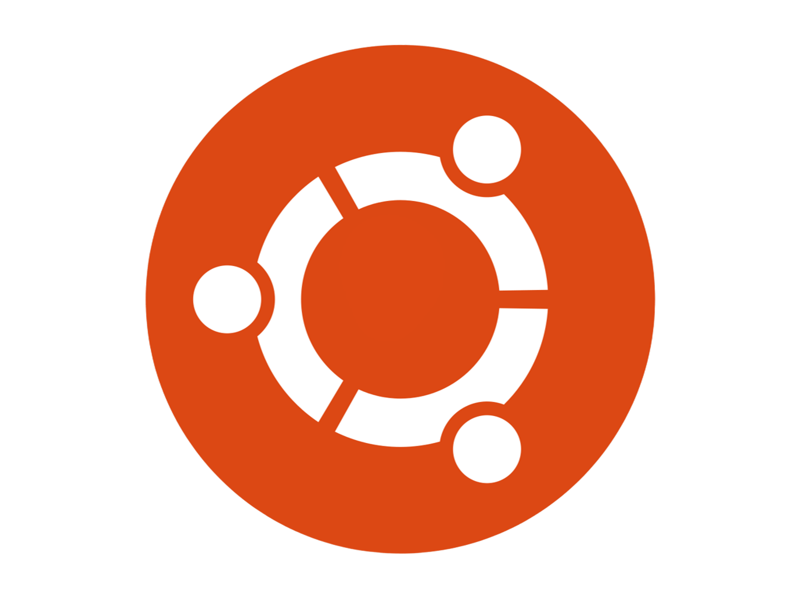
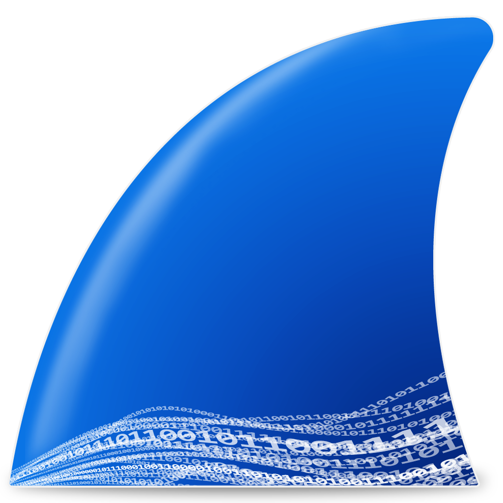
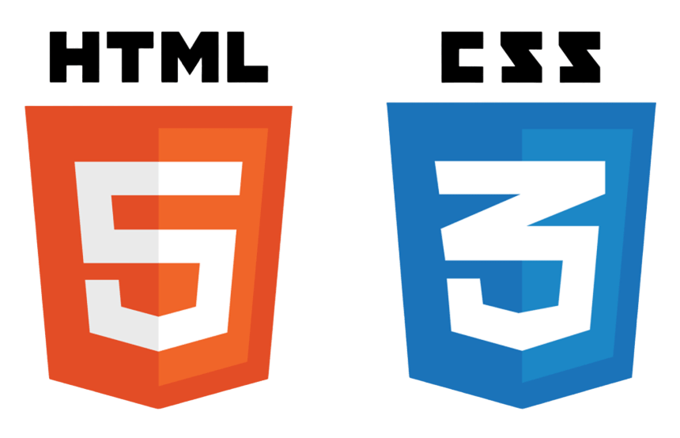
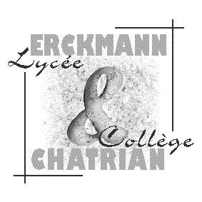
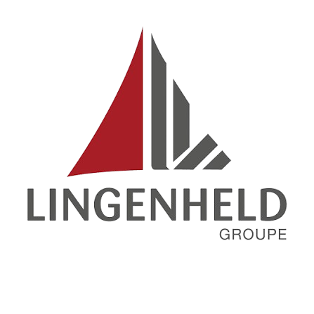
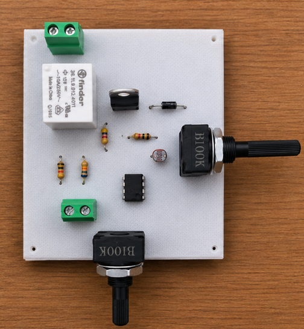
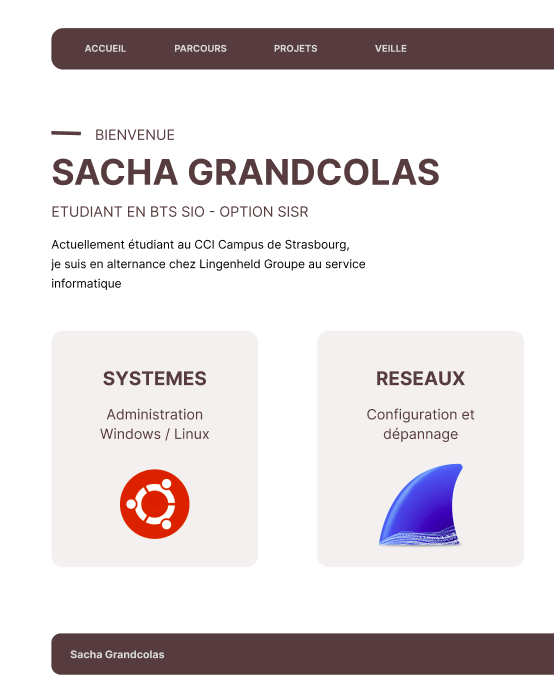
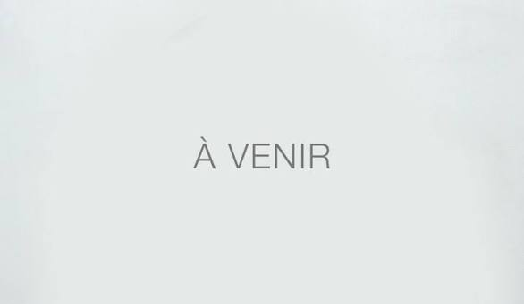
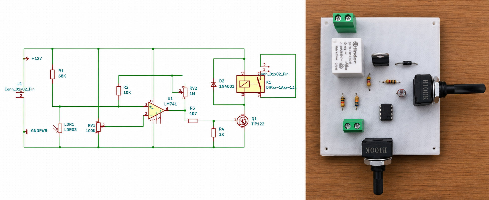
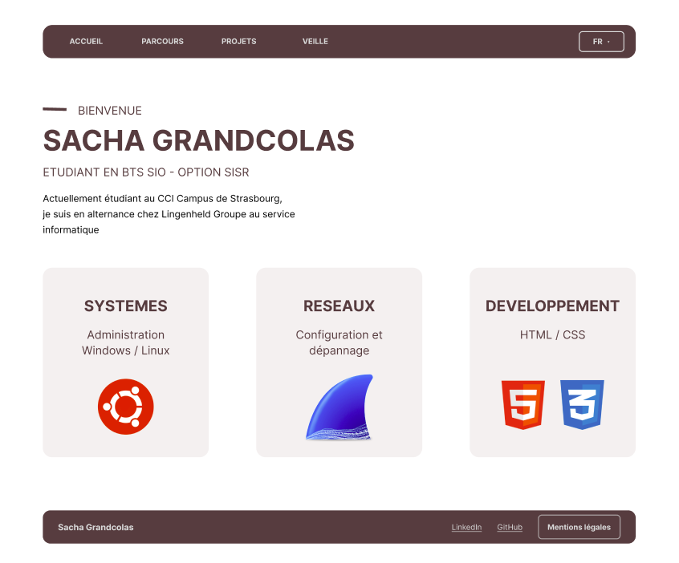

# Contenu
**Date de création** : 16/10/2026 - S.GRANDCOLAS
**Date de modification** : 27/11/2026 - S.GRANDCOLAS
**Sommaire :**

> [TOC]

## 1. Éléments présents dans toutes les pages

### 1.1. Menu de navigation

Accueil, Parcours, Projets, Veille technologique, FR / EN

### 1.2. Pied de page

Sacha GRANDCOLAS, GitHub, LinkedIn, Mentions légales

## 2. Page Accueil

Bienvenue  

SACHA GRANDCOLAS 

ÉTUDIANT EN BTS SIO - OPTION SISR

Actuellement étudiant au CCI Campus de Strasbourg, je suis alternant chez Lingenheld au service informatique 

Systèmes : Administration Windows / Linux	

Réseaux : Configuration et dépannage	

Développement : HTML / CSS	

## 3. Page Parcours

Mon parcours

Vous pouvez ici retrouver l'ensemble de mon parcours scolaire et professionnel.

Scolaire :

2026 - 2028	BTS SIO - option SISR	CCI Campus - Strasbourg	

2023 - 2026	Baccalauréat Professionnel CIEL	Lycée Mangin - Sarrebourg	

2019 - 2023	Collège 	Cité scolaire Erckmann-Chatrian - Phalsbourg	

Professionnel : 

2026 - 2028	Lingenheld	Dabo - Alternance au service informatique	

2024 - 2026	Ferco	Réding - Stage au service informatique	

2023 - 2024	FM Logistic	Phalsbourg - Stage au service informatique	

## 4. Page Projets

### 4.1. Introduction

Mes projets

Vous pouvez ici retrouver l'ensemble des projets que j'ai réalisés durant mon BAC professionnel CIEL et mon BTS SIO.

**La carte électronique**

Ce projet consiste à concevoir une carte électronique permettant de détecter la luminosité ambiante grâce à un capteur crépusculaire. J'ai réalisé le schéma électronique et le routage du circuit imprimé avec KiCad. La carte a ensuite été fabriquée par usinage à l'aide de la machine CNC et du logiciel Perceval.

Voir plus 

**Le portfolio**

Ce projet consiste à créer mon portfolio personnel afin de présenter mon parcours, mes compétences et mes différents projets. Je réalise les maquettes sur Figma, puis je développe le site en HTML, CSS et JavaScript.

Voir plus 

**Atelier de professionnalisation 3**

Ce projet est à venir.

Voir plus 

**Atelier de professionnalisation 4**

Ce projet est à venir.

Voir plus 

## 5. La carte électronique

La carte électronique

Vous pouvez ici retrouver mon projet de conception d’une carte électronique que j’ai eu l’occasion de faire au lycée.

Lors de ce projet fait au lycée j'ai dû fabriquer une carte électronique de la conception du PCB à la fabrication de la carte à l’aide d’une machine CNC.

Tout d'abord j'ai choisi un projet parmi une liste proposée par mes professeurs, après réflexion mon choix s'est porté sur un interrupteur crépusculaire, c'est-à-dire une lumière qui s'allume automatiquement dans l'obscurité et inversement qui s'éteint lorsque la luminosité augmente à nouveau.

Ensuite, j'ai utilisé KiCad pour créer le schéma, le PCB ainsi que le routage des pistes.

Enfin, le logiciel Perceval m'a permis de contrôler la graveuse CNC qui a ensuite tracé et gravé les pistes sur des plaques en cuivre.

## 6. Le portfolio

Le portfolio

Vous pouvez ici retrouver la création de mon portfolio, de la conception des maquettes au développement du site.

Pour ce projet, j'ai dû créer mon propre portfolio afin de présenter mon parcours scolaire, mes compétences et les différents projets que j'ai réalisés.

Tout d'abord, j'ai réfléchi à l'organisation du site et à son apparence. J'ai alors réalisé les différentes maquettes sur Figma afin de définir le design et la disposition des éléments sur chaque page.

Ensuite, j'ai commencé le développement du site en utilisant HTML, CSS et JavaScript pour créer les pages et mettre en place leur mise en forme.

Enfin, j'utilise Git et GitHub pour suivre l'avancement du projet et conserver les différentes versions de mon travail.

## 7. Atelier de professionnalisation 3

L'atelier de professionnalisation 3

Vous pouvez ici retrouver mon atelier de professionnalisation numéro 3.

Ce projet est à venir.

Illustration : à venir
Compétences du référentiel mobilisées : à venir
Documents de présentation : à venir
Documentation technique : à venir
Documentation utilisateur : à venir

## 8. Atelier de professionnalisation 4

L'atelier de professionnalisation 4

Vous pouvez ici retrouver mon atelier de professionnalisation numéro 4.

Ce projet est à venir.

Illustration : à venir
Compétences du référentiel mobilisées : à venir
Documents de présentation : à venir
Documentation technique : à venir
Documentation utilisateur : à venir

## 9. Page Veille technologique

Ma veille technologique

Vous pouvez ici retrouver l'ensemble des articles de presse concernant l'informatique que j'ai eu l'occasion de lire.

Une panne mondiale touche Outlook et Microsoft 365

Date de publication : 13/11/2026

Source : https://www.franceinfo.fr/internet/microsoft/une-panne-mondiale-touche-la-messagerie-outlook-de-microsoft-les-mesures-pour-la-resoudre-ne-fonctionnent-pas-comme-prevu_8280422.html

Résumé : Une panne mondiale a touché Outlook et plusieurs services de Microsoft 365 notamment Teams et Copilot. Des milliers d'utilisateurs dans 74 pays ont rencontré des difficultés pour accéder à leurs services. Microsoft a indiqué que ses premières mesures pour résoudre le problème ne fonctionnaient pas comme prévu et a dû chercher d'autres solutions.

Faille de sécurité critique dans Alpine Linux et OpenSSH

Date de publication : 09/11/2026

Source : https://www.zdnet.fr/actualites/alpine-linux-et-openssh-corrigent-une-faille-dune-gravite-sans-precedent-507570.htm

Résumé : Une faille de sécurité dans OpenSSH touche Alpine Linux et certaines autres distributions qui utilisent la bibliothèque musl. Elle permet à un attaquant de contourner l'authentification SSH et d'accéder à certains comptes sans connaître leur mot de passe. Debian, Ubuntu et Fedora ne sont pas concernés, pour corriger cette faille Alpine Linux a publié des mises à jour de sécurité et recommande de mettre à jour les paquets concernés puis de redémarrer le service SSH.

L'IA d'Anthropic trouve des failles dans plusieurs systèmes 

Date de publication : 02/11/2026

Source : https://www.clubic.com/actualite-637039-l-ia-d-anthropic-a-perce-les-defenses-de-linux-chrome-et-safari-en-un-claquement-de-doigts.html

Résumé : Anthropic affirme que son IA a découvert et exploité des failles critiques dans Chrome, Safari, Android, Windows et Linux, ces failles permettaient notamment de prendre le contrôle de machines ou d’accéder à des données. Toutes ces failles ont été corrigées avant leur publication.

Changement de l'inscription Windows dans Intune

Date de publication : 02/11/2026

Source : https://www.it-connect.fr/enterpriseenrollment-ce-qui-change-pour-linscription-des-postes-windows-dans-intune/

Résumé : À partir du 15 janvier 2027 Windows ne trouvera plus automatiquement Intune lors de l'inscription d'un ordinateur en mode MDM-only. Les utilisateurs vont devoir saisir manuellement l'adresse du serveur Intune, les ordinateurs déjà inscrits ne sont pas concernés.

Les failles PHP

Date de publication : 21/10/2026

Source : https://www.lemonde.fr/pixels/article/2026/10/21/failles-php-pourquoi-de-nombreux-sites-ont-soudainement-ete-mis-en-maintenance_6798279_4408996.html

Résumé : Deux grosses failles de sécurité ont été trouvées sur PHP, un langage très utilisé sur les sites internet. Face à cela beaucoup de sites dans le monde se sont mis en maintenance par précaution pour éviter de se faire pirater en attendant les mises à jour, finalement la mise à jour corrigeant ces failles a été publiée peu de temps après.

## 10. Page Mentions légales

Les mentions légales

Vous pouvez ici retrouver les mentions légales de ce site web.

*Dernière mise à jour : 27 novembre 2026*

### 10.1. Éditeur du site

Ce site est édité par :

Sacha GRANDCOLAS

Email : sacha.grandcolas@ccicampus.fr

Statut : étudiant en BTS SIO (Services informatiques aux organisations) option SISR, en alternance au CCI Campus Strasbourg.

Ce site est un portfolio personnel à but pédagogique et non commercial, réalisé dans le cadre de ma formation.

### 10.2. Directeur de la publication

Le directeur de la publication est Sacha GRANDCOLAS, en qualité d'éditeur du site.

### 10.3. Hébergement

L'hébergeur sera précisé lors de la mise en ligne du site.

### 10.4. Propriété intellectuelle

Sauf mention contraire, les contenus de ce site (textes, images, code et mise en page) sont la propriété de Sacha GRANDCOLAS. Toute reproduction, représentation, modification ou diffusion, totale ou partielle, sans autorisation écrite préalable de l'auteur est interdite et constitue une contrefaçon sanctionnée par les articles L335-2 et suivants du Code de la propriété intellectuelle.

Les logos, noms et marques des entreprises, des établissements scolaires et des outils informatiques présentés sur ce site restent la propriété de leurs titulaires respectifs. Ils sont utilisés uniquement à des fins d'illustration de mon parcours et de mes compétences. Leur présence n'implique aucun partenariat ni aucune approbation de la part de leurs titulaires. Tout titulaire peut demander le retrait de son logo à l'adresse indiquée dans la section « Éditeur du site ».

### 10.5. Données personnelles et cookies

Ce site ne collecte aucune donnée personnelle : il ne comporte ni formulaire, ni outil de statistiques, ni traceur. Aucun cookie n'est déposé sur votre terminal.

Conformément au Règlement général sur la protection des données (RGPD) et à la loi Informatique et Libertés, vous disposez d'un droit d'accès, de rectification, d'effacement et d'opposition concernant vos données. Pour toute question à ce sujet, vous pouvez me contacter à l'adresse indiquée dans la section « Éditeur du site ». Vous pouvez également saisir la CNIL ([www.cnil.fr](https://www.cnil.fr)).

### 10.6. Responsabilité

Je m'efforce de fournir des informations exactes et à jour, mais je ne peux garantir l'absence d'erreurs ou d'omissions. L'éditeur ne saurait être tenu responsable d'un dommage résultant de l'utilisation des informations présentes sur ce site.

### 10.7. Liens externes

Ce site peut contenir des liens vers des sites tiers. Je n'exerce aucun contrôle sur leur contenu et décline toute responsabilité à leur égard.

### 10.8. Droit applicable

Le présent site et ses mentions légales sont soumis au droit français. En cas de litige, les tribunaux français sont seuls compétents.

